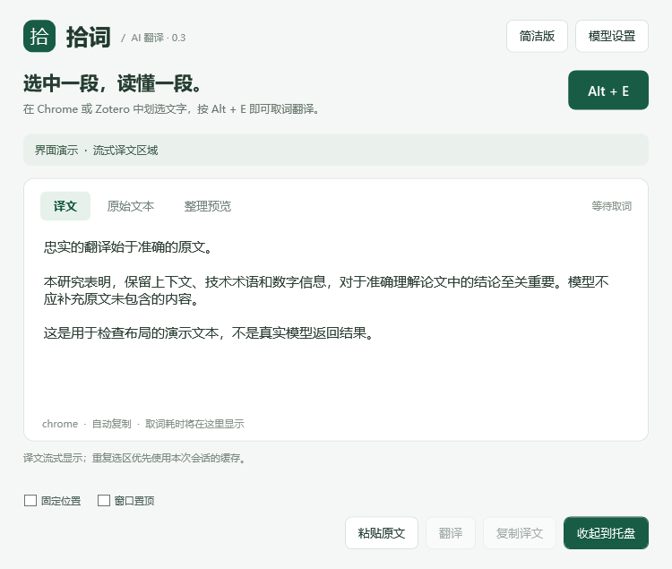
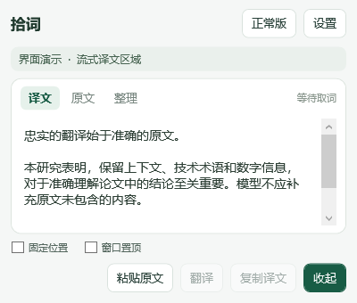

# 拾词 · AI 划词翻译

拾词是一款 Windows 后台划词翻译工具，主要用于 Chrome 网页、带文字层的 PDF 和 Zotero。选中文字后按 **Alt + E**，即可读取原文并调用配置的 AI 模型翻译。不使用 OCR，原文始终保留，可切换译文、原文和整理预览。

## 窗口与阅读

**0.3 支持固定位置和简洁版。** 将窗口拖到合适的位置，勾选底部“固定位置”，以后按快捷键就会在该位置显示；仍可拖动标题栏，软件会记住新位置。“窗口置顶”独立控制是否显示在其他窗口上方。

右上角“简洁版 / 正常版”可随时切换，当前原文、译文和正在输出的翻译保留。正常版默认 770 × 685，简洁版默认 420 × 380，尺寸以 Windows 逻辑像素计。两种模式都支持拖动边框、右下角缩放柄、最大化和还原，并分别保存位置、大小和最大化状态；最大化窗口不会因快捷键弹出而被还原。更换显示器后会将不可见的位置调整回可用工作区。





图中的文字为离屏布局测试样本，不是真实模型返回结果。

## 使用

需要 Windows x64 和 .NET Framework 4.8。打开拾词，在右上角“模型设置”填写服务商的 API Key；没有 Key 也可以先验证取词。默认预设为 Qwen-MT-Flash，其他模型与价格参考见 [MODELS.md](MODELS.md)，价格以服务商当日页面为准。

在目标网页或 PDF 划选一段文字，按 Alt + E 并松开。启用“取词后自动翻译”时会流式显示译文；否则先核对原文，再点击“翻译”。自动取词失败时，可先在原页面按 Ctrl+C，再点“粘贴原文”，核对后手动翻译。

点击“收起到托盘”会保留正在进行的翻译；点击窗口关闭按钮或按 Esc 会取消翻译并隐藏窗口。双击托盘图标重新显示窗口，右键托盘选择“退出拾词”才会结束程序。升级前应先退出旧版，否则再次启动会显示旧的后台实例。程序不会自行配置开机启动，可用 `--background` 参数启动到托盘。

## 构建、安装与桌面快捷方式

项目使用 C#、WPF 和系统自带的 .NET Framework 编译器，无需 Node.js、Python 或 NuGet 下载。克隆后在 PowerShell 中运行：

```powershell
.\build.ps1 -OutputDirectory dist\0.3
.\test.ps1
.\install-local.ps1
```

安装脚本把已构建的 0.3 程序复制到项目根目录的 `拾词.exe`，并创建指向该稳定路径的“拾词”桌面快捷方式。应保留旁边的 `拾词.exe.config`；以后更新根目录程序即可继续使用原快捷方式。脚本不会自动启动或结束正在运行的程序。需要自定义构建目录时使用 `-BuildDirectory`；不创建桌面快捷方式时使用 `-SkipDesktopShortcut`。

## 取词与数据

自动模式在 Chrome、Zotero、Edge 和 Firefox 优先模拟 Ctrl+C，等待所有相关按键松开并稳定 60 ms 后才复制。1.4 秒没有新文本时，尝试最多等待 900 ms 的系统选区接口；复制成功不额外等待。设置中的“始终直接复制”关闭系统备用路径，“优先系统选区”则先读取选区再尝试复制。

快捷键取词只接受序列号更新且所有者属于目标进程的剪贴板文本，不会自动翻译旧剪贴板。复制前备份可安全读取的格式，完成后仅在剪贴板没有被后来操作替换时恢复。剪贴板锁定、特殊对象、代理所有者、管理员权限不一致或禁止复制的页面可能导致失败；系统剪贴板历史和第三方剪贴板管理器仍可能记录复制操作。

原文整理只保守合并部分行内换行和软连字符，不猜测修复双栏顺序、字体映射错误或扫描 PDF。取词上限为 10 万字符，单次翻译上限为 12,000 字符。模型输出不完整时不会当作成功结果缓存；API 请求不会自动重试。

模型设置位于 `%LOCALAPPDATA%\Shici\settings.json`，API Key 使用 Windows DPAPI 当前用户范围加密。窗口偏好单独存于 `window.json`，调整位置不会改写模型账户设置。取词在本机执行；翻译仅向用户配置的接口提交当前原文，不上传截图或文档全文。原文和译文不写入磁盘历史，成功翻译仅保留最多 24 条会话内缓存。

## 验证与开发

`test.ps1` 运行文本、选区调度、按键释放、模拟 HTTP 流式响应、取消、缓存、设置和窗口偏好的回归检查，并离屏渲染两种界面。验证范围及限制见 [VALIDATION.md](VALIDATION.md)。开发时可运行 `node tests/serve-fixtures.mjs`，再访问本机 `http://127.0.0.1:18764` 测试网页和 PDF 选区。

代码位于 `src/`，主界面位于 `ui/Main.xaml`。取词由 `CaptureEngine`、`ClipboardCapture` 和 `CapturePolicy` 处理；模型请求由 `TranslationClient` 处理；两种窗口布局和偏好分别由 `WindowLayout` 与 `WindowPreferences` 处理。仓库不包含个人配置、API Key、翻译历史或本机构建产物。
